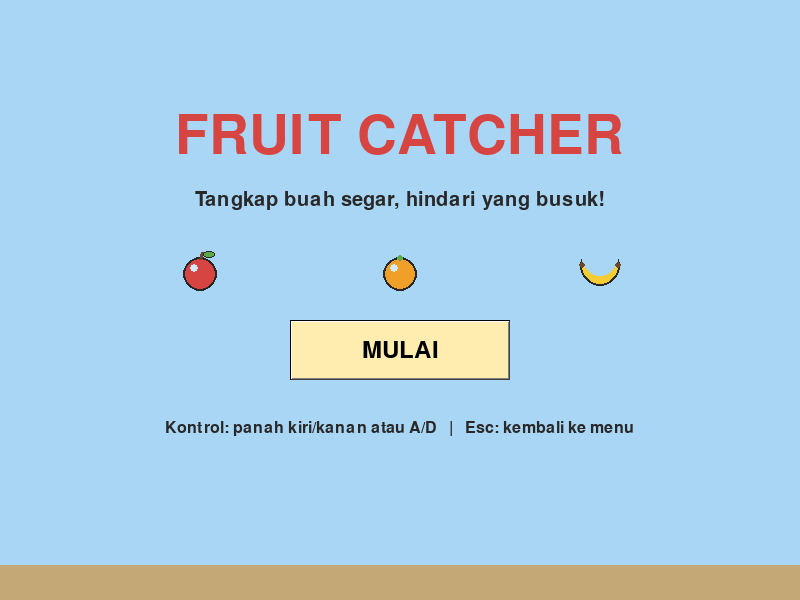
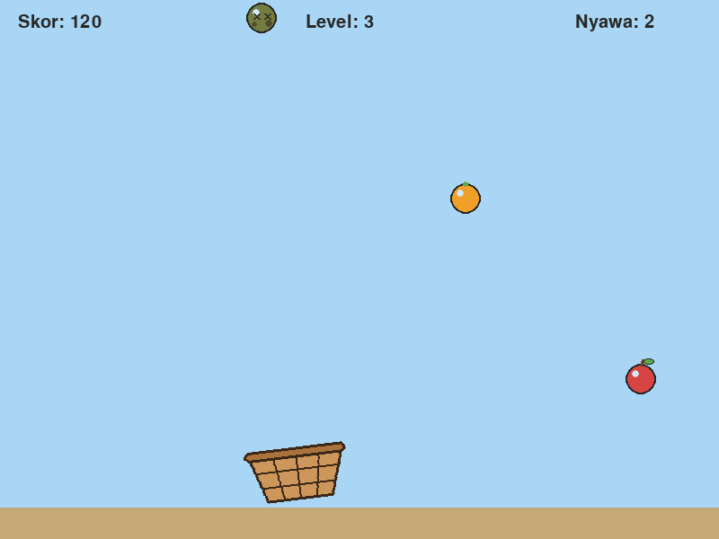
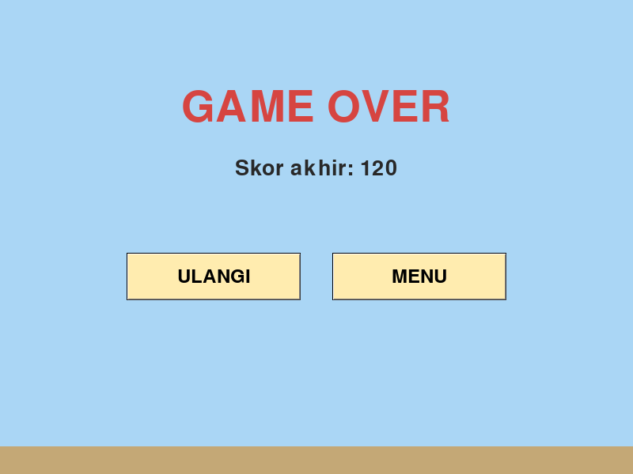

# Fruit Catcher

A 2D arcade game made with **Python**, **Pygame** and **Pygwidgets**. Move the basket to catch fresh fruit, avoid the rotten ones, and reach **300 points** before you lose all **3 lives**.

This is the final project for an Object-Oriented Programming course. All graphics and sounds are self-made: pixel art drawn with code and 8-bit chiptune audio made with a small synthesizer script.

| Menu | Gameplay | Game over |
|---|---|---|
|  |  |  |

## How to play

| Input | Action |
|---|---|
| Left arrow / `A` | Move basket left |
| Right arrow / `D` | Move basket right |
| Mouse click | Press **MULAI** (start), **ULANGI** (retry) and **MENU** |
| `Esc` | Leave the game and go back to the menu |

- **Apple** and **orange**: +10 points. **Banana**: +20 points.
- **Rotten fruit**: −1 life.
- **Every 50 points** the level goes up. Fruit falls faster, spawns more often, and more of it is rotten.
- **Win** at 300 points. **Lose** when all 3 lives are gone. You can play again without restarting the program.

The in-game text is in Indonesian.

## Running from source

Requires Python 3.13. Pygame 2.6.1 has no wheels for Python 3.14 yet.

```bash
python3.13 -m venv .venv
.venv/bin/python -m pip install pygame==2.6.1 pyinstaller
.venv/bin/python -m pip install --no-deps pygwidgets==1.1.2
.venv/bin/python main.py
```

> **Why `--no-deps`?** Pygwidgets 1.1.2 lists `pygame-ce` as a dependency. `pygame-ce` installs into the same `pygame` module as the original Pygame, so having both breaks things. Pygwidgets does not use any CE-only API and works fine with Pygame 2.6.1.

On Windows, use `.venv\Scripts\python` instead of `.venv/bin/python`.

### Tests

The tests run without opening a window, using SDL's dummy video and audio drivers:

```bash
.venv/bin/python -m unittest discover -s tests -t . -v
```

### Building the Windows executable

Run this on Windows. PyInstaller only builds for the OS it runs on.

```bash
pyinstaller --onefile --windowed --add-data "assets;assets" main.py
```

The result is `dist/main.exe`. All asset paths go through `path_aset()` in `aset.py`, which resolves files from PyInstaller's `sys._MEIPASS` folder when running as an `.exe`.

## Project structure

```
main.py        entry point (one line: Game().run())
game.py        BaseGame, Game
sprites.py     Basket, FallingItem, GoodFruit, RottenFruit
aset.py        path_aset(), AssetManager
config.py      tuning values (window, speeds, scores, difficulty)
assets/        images/ and sounds/ (generated by tools/)
tools/         scripts that generate the sprites and sounds
tests/         unit tests
docs/          UI sketches and screenshots
```

## Class design

| Class | Responsibility |
|---|---|
| `BaseGame` | Opens the window and runs the game loop (events, update, draw) with an FPS limit |
| `Game(BaseGame)` | Game states (menu, playing, game over), spawning, collisions, levels, UI widgets |
| `Basket` | The player: movement, screen bounds, frame animation, score and lives |
| `FallingItem` | Base class for falling objects. Removes itself after leaving the screen |
| `GoodFruit(FallingItem)` | Adds points when caught |
| `RottenFruit(FallingItem)` | Takes a life when caught |
| `AssetManager` | Loads images and sounds once, with `try`/`except` and clear error messages |

OOP concepts used:

- **Inheritance:** `Game` extends `BaseGame`. `GoodFruit` and `RottenFruit` extend `FallingItem`. Each subclass calls `super().__init__()` and overrides behaviour.
- **Polymorphism:** `Game` calls `item.on_caught(basket)` without checking the fruit type.
- **Encapsulation:** internal attributes use a `_` prefix. `Basket.speed`, `Basket.lives` and `Basket.score` are properties whose setters raise `ValueError` on invalid values.

## Assets

All assets are self-made for this project. To regenerate them:

```bash
.venv/bin/python tools/buat_keranjang.py   # basket, 3 animation frames
.venv/bin/python tools/buat_buah.py        # apple, orange, banana, rotten fruit
.venv/bin/python tools/buat_suara.py       # sound effects and background music (WAV)
```

## Built with

- [Pygame](https://www.pygame.org/) 2.6.1
- [Pygwidgets](https://github.com/IrvKalb/pygwidgets) 1.1.2
- [PyInstaller](https://pyinstaller.org/)
